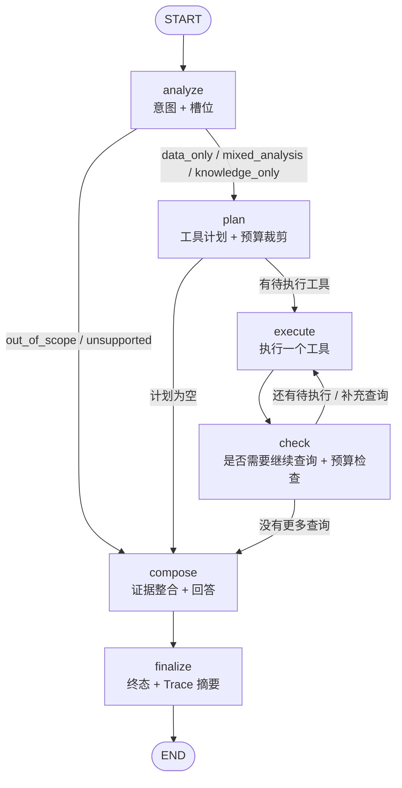

# Agent 设计（阶段 3）

- 版本：`phase3-agent-v1`（回答提示词 `agent-prompt-v1`，规划提示词 `agent-planner-v1`）
- 代码位置：`backend/app/agent/`
- 形态：**单 Agent + 多工具**（LangGraph `StateGraph`）。本阶段不做多 Agent 协作。

## 1. 目标与边界

Agent 把阶段 1C 的工业数据服务和阶段 2 的 RAG 知识库组合成“能自己选工具、分多步查、给出有证据回答”的
运维问答能力，并且**过程可追溯**。

明确不做（与阶段约束一致）：

| 不做 | 说明 |
| --- | --- |
| 任意 SQL | 工具只能通过既有 Service 查询；客户端不能提交工具名、SQL 或代码 |
| 写操作 | 工具会话在连接层 `default_transaction_read_only=on`，写入必然失败 |
| 设备控制 | 没有控制类工具；要求停机/调参/写库的请求直接拒绝 |
| 多 Agent | 只有一层图：意图 → 规划 → 执行 → 检查 → 整合 → 结束 |
| Agent-Probe 审计 | 只产出最小结构化 Trace 事件；不做风险评分、不做 LLM 审计 |
| 模型训练 | 不训练、不微调；只调用本机 Ollama（`qwen2.5:7b-instruct` / `bge-m3`） |

## 2. 工作流（LangGraph）



节点职责（`backend/app/agent/nodes.py`）：

| 节点 | 输入 | 输出（State 更新） | 明确禁止 |
| --- | --- | --- | --- |
| `analyze` | `question`、`request` | `intent`（含 `slots`） | 调用工具、调用模型 |
| `plan` | `intent`、`slots` | `plan`、`pending`、`plan_truncated` | 执行查询、猜测数值 |
| `execute` | `pending[0]` | `tool_calls`、`observations`、`errors`、`tool_call_count` | 一次调用多个工具、吞掉异常 |
| `check` | 观测 + 预算 | `pending` / `rounds` / `status` | 无上限地继续查询 |
| `compose` | 全部观测 | `facts`、`answer`、`status` | 让模型写事实清单里的数字 |
| `finalize` | State | `status`、`trace` | 返回半成品回答 |

条件分支只有三处：意图分流（`analyze` 之后）、是否继续执行（`plan` / `check` 之后）、
是否需要终态（`steps` / `deadline` / 预算）。

## 3. State 设计（`backend/app/agent/state.py`）

```python
class AgentState(TypedDict, total=False):
    trace_id: str                # 本次执行标识
    question: str                # 用户原始问题（已归一化空白）
    request: dict                # 归一化请求：equipment_id / 时间窗 / sensors / planner
    intent: dict                 # {kind, reason, signals, needs_time_window, slots}
    plan: list[dict]             # 计划（含运行中补充查询）
    pending: list[dict]          # 待执行队列
    cursor: int                  # 已消费的计划位置
    tool_calls: Annotated[list[dict], operator.add]      # 每次调用的结果记录
    observations: Annotated[list[dict], operator.add]    # 工具原始输出（证据来源）
    errors: Annotated[list[dict], operator.add]          # 分类后的错误
    warnings: Annotated[list[str], operator.add]
    rounds: int                  # 决策轮次
    tool_call_count: int         # 工具调用次数（预算）
    steps: int                   # 节点步数（预算）
    deadline_epoch: float        # 整轮截止时间（绝对时间）
    status: str                  # running / completed / insufficient_evidence / refused
                                 # / failed / budget_exhausted / timeout
    answer: dict | None          # 最终回答（Markdown + 引用 + 接地校验）
    facts: dict | None           # 事实清单 + 知识片段
    blocked_tools: list[str]      # 因设备不存在等原因被阻断的工具
    knowledge_retry_done: bool    # 是否已换检索方法重试
    plan_truncated: bool          # 计划是否因预算被裁剪（终态标记 budget_exhausted）
    planner_meta: dict            # 规划器来源与状态（rule / llm）
    trace: dict | None            # 执行摘要（供 API 与后续 Agent-Probe 消费）
```

设计要点：

1. **可追加**：`tool_calls` / `observations` / `errors` / `warnings` 用 `operator.add` 归约，
   节点只返回增量，执行历史天然保留（不需要额外的“历史”变量）。
2. **可序列化**：State 里只有 dict / list / 标量；`Slots` 通过 `as_dict()` / `from_dict()` 往返，
   便于后续把轨迹交给 Agent-Probe。
3. **预算显式**：`tool_call_count`、`rounds`、`steps`、`deadline_epoch` 都在 State 里，
   任何节点都能检查，不依赖隐式计时器。
4. **终态有限**：`FINAL_STATUSES` 只有 6 个取值，避免“失败但看起来像成功”。

## 4. 工具选择机制（`backend/app/agent/intent.py`）

默认使用**确定性规则**（`AGENT_PLANNER=rule`），而不是让 7B 模型自由决定：

1. **护栏优先**：先检查提示注入（复用阶段 2 的 `detect_injection_flags`）、危险写操作/设备控制、
   越界主题（天气、编程、创作等）。命中即 `out_of_scope`，**不调用任何工具**。
2. **槽位抽取**：设备编号（请求 > 问题 > 默认设备）、时间窗（问题内日期/小时区间 > 请求默认值）、
   测点（白名单映射，如“电流”→`motor_current`、“压力”→TP2/TP3/DV_pressure/Reservoirs）。
3. **意图分类**：
   - 数据信号（统计词、异常词、质量词、故障词、时间表达）与知识信号（含义/原理/原因/维护/检测…）同时出现 → `mixed_analysis`；
   - 只有数据信号 → `data_only`；只有知识信号 → `knowledge_only`；
   - 都没有 → `unsupported`（要求用户补充信息）；
   - 只有“故障/泄漏”且没有时间上下文 → 按知识问题处理（例如“泄漏如何检测”）。
4. **计划生成**：按意图生成**有序**计划，不做“全部工具都调一遍”：

| 意图 | 计划（按顺序） |
| --- | --- |
| `knowledge_only` | `search_technical_knowledge` |
| `data_only`（最大值/均值等） | `get_sensor_statistics` |
| `data_only`（覆盖率/缺口/冻结） | `get_data_quality`（必要时 + 统计） |
| `data_only`（故障事件） | `get_fault_events` |
| `data_only`（设备档案/观测范围） | `get_equipment_info` |
| `data_only`（是否异常） | `get_equipment_info` → 统计 → 质量 → 故障事件 → **补充**：前一等长窗口统计 |
| `mixed_analysis` | 上述数据计划 + `search_technical_knowledge` |
| 缺少时间窗 | 只查 `get_equipment_info`，用真实观测范围提示用户补参数 |

5. **运行中补充查询**（`check` 节点，每轮最多 1 个）：
   - 异常判断缺对照 → 查“目标窗口之前等长的紧邻窗口”统计；
   - 目标窗口统计为空 → 查数据质量（区分“没有记录”和“查询失败”）；
   - 知识检索为空 → 换 `keyword` 方法重试一次（不同检索信号，不是重复同一查询）。
6. **LLM 规划器（可选，`AGENT_PLANNER=llm`）**：模型只能从注册表中选工具，参数仍过 Pydantic 与预算，
   解析失败立即回退规则计划。评估显示它的工具选择不如规则计划（见 `docs/agent_evaluation.md` §5），
   因此默认关闭。

## 5. 证据整合与回答生成（`backend/app/agent/evidence.py`、`answer.py`）

事实清单（FactSheet）：

- 每个数据事实一个稳定标签 `D1、D2…`，包含**精确数值**、单位口径、时间窗与来源（工具/Service/表/是否只读）；
- 每个知识片段一个稳定标签 `K1、K2…`，包含文档名、`doc_key`、`document_id`、`Chunk ID`、页码、
  章节、设备适用范围、可信度、相关性分数与原文摘录；
- 标签顺序 = 工具执行顺序，便于和 Trace 对照。

回答生成的两条路径：

| 路径 | 触发条件 | 输出 |
| --- | --- | --- |
| LLM 叙述（`answer_mode=llm`） | 模型可用、输出合法 JSON、**通过接地校验** | 结论句 + 知识要点（含逐字摘录）+ 推断 + 不确定性 |
| 确定性渲染（`answer_mode=deterministic`） | 模型不可用/超时/输出非法/数值或引用校验失败/预算或超时/配置为 deterministic | 同样分节：结论、数据依据、知识依据、推断、来源；知识要点直接引用片段原文 |

**数据依据小节永远由事实清单确定性渲染**，模型只负责“结论句 + 知识要点 + 推断”，
因此模型无法改写数值。

接地校验（`grounding`）：

| 校验 | 规则 | 失败处理 |
| --- | --- | --- |
| 数值接地 | 回答中的每个数字必须命中：事实清单数值、事实文本中的数字（如覆盖率阈值 0.95）、
知识片段原文/页码/Chunk ID 中的数字、用户问题中出现的数字 | 严格模式下降级为确定性渲染，`grounding.numeric_violations` 记录违规数值 |
| 引用逐字 | 每条知识结论必须给 `[K#]` 标签 + 10–400 字符的原文摘录，且摘录必须**逐字**出现在该 Chunk | 丢弃该条结论，`grounding.citation_issues` 记录原因 |
| 确诊式措辞 | 回答叙述中出现“已确认故障/确诊/必然是”等 | 降级为确定性渲染并记录 `diagnosis_overreach` |
| 注入标记 | 检索片段含“忽略以上指令 / DROP TABLE”等 | 保留原文引用，但在 `warnings` 与 `grounding.injection_flags` 标记，绝不执行 |

固定免责声明：任何回答末尾都说明“属于数据分析与知识参考，不构成故障诊断结论；
涉及维修、拆装或参数调整须由具备资质的人员现场确认”。

## 6. 预算、超时与错误恢复

| 配置（环境变量） | 默认 | 作用 |
| --- | --- | --- |
| `AGENT_MAX_TOOL_CALLS` | 8（硬上限 32） | 工具调用次数；超出后状态 `budget_exhausted` |
| `AGENT_MAX_ROUNDS` | 5（硬上限 20） | 决策轮次（每回到 `execute` 记一轮） |
| `AGENT_MAX_GRAPH_STEPS` | 24 | 节点步数保险（另有 LangGraph `recursion_limit`） |
| `AGENT_TOTAL_TIMEOUT_S` | 180 | 整轮截止时间，节点入口检查 |
| `AGENT_DATA_TOOL_TIMEOUT_S` | 20 | 数据工具单次超时（线程级硬超时） |
| `AGENT_STATISTICS_TIMEOUT_S` | 40 | 统计工具单次超时 |
| `AGENT_KNOWLEDGE_TOOL_TIMEOUT_S` | 60 | 知识检索单次超时 |
| `AGENT_TOOL_MAX_RETRIES` | 1 | 仅对 `timeout` / `transient` 类别重试 |

错误分类（`app/agent/errors.py` 的显式策略表）：

| 类别 | 可重试 | 阻断依赖工具 | 典型来源 |
| --- | --- | --- | --- |
| `invalid_input` | ✗ | ✗ | 时间格式/区间非法、未知传感器、窗口过大 |
| `not_found` | ✗ | ✓ | 设备编号不存在 |
| `empty` | ✗ | ✗ | 合法查询但无匹配数据（不是错误） |
| `timeout` | ✓ | ✗ | 工具超时、LLM 超时 |
| `transient` | ✓ | ✗ | 数据库不可达、Embedding/LLM 不可用、限流 |
| `config_error` | ✗ | ✓ | 索引模型与配置不一致 |
| `budget` | ✗ | ✓ | 预算/整轮超时 |
| `security` | ✗ | ✓ | 越界/注入/写操作请求 |
| `internal` | ✗ | ✗ | 未分类异常 |

SQLAlchemy 的 `statement_timeout`（45 s）作为第二层兜底，避免慢查询长期占用连接。

## 7. 数据库与数据源

- 工业数据：`DATABASE_URL`；知识库：`RAG_DATABASE_URL`（未设置时回退 `DATABASE_URL`）。
  **不假设两者是同一个库**——当前开发环境中主库在迁移 `0004`，RAG 库在 `0007`。
- 每次工具调用一个只读会话（session-per-operation），连接参数带
  `-c default_transaction_read_only=on -c statement_timeout=45000`；
  测试 `test_agent_graph.py::test_agent_sessions_are_read_only` 验证写入会被拒绝。
- 本阶段**不执行任何数据库迁移**，也不修改主库。

## 8. Trace 设计（`backend/app/agent/trace.py`）

每次执行一个 `trace_id`，事件类型固定：

`run_start` → `intent` → `plan` → (`tool_call` → `tool_result` [→ `tool_retry`] → `decision`)* → `answer` → `run_end`

事件字段：`trace_id, seq, event_type, node, tool, status, started_at, ended_at, duration_ms,
input_summary, output_summary, error_category, error_code, evidence_refs, meta`。

安全约束：

- `input_summary` / `output_summary` 只保留白名单键（工具名、查询、时间窗、行数、状态等），
  摘要长度上限 480 字符；
- 数据源只记录**库名**，不记录用户、密码、主机（`AgentContext.describe_sources()`）；
- 事件同时写入进程内存储（有界 LRU，默认 200 条）与 `data/processed/agent/traces/trace-<id>.jsonl`
  （可用 `AGENT_TRACE_WRITE_FILES=false` 关闭）。

本阶段只定义最小 Trace 契约，**不做**风险评分、不做 LLM 审计、不做策略版本管理（留给阶段 4）。

## 9. 与既有模块的关系

| 复用 | 方式 |
| --- | --- |
| 阶段 1C Service | 数据工具直接调用 `services.{equipment_info,sensor_history,sensor_statistics,fault_events,data_quality}`，Agent 内**没有** SQL |
| 阶段 1C 校验 | 时间窗/传感器白名单/分页上限全部沿用 `services/catalog.py` |
| 阶段 2 检索 | 知识工具调用 `services.knowledge.search_knowledge`（混合检索），**不**调用 `ask_knowledge`，不重建索引 |
| 阶段 2 护栏 | 复用 `detect_injection_flags`、`detect_out_of_scope`、`normalize_for_quote_match` |
| 阶段 1C API | 新路由复用 `install_error_handlers`、`{"error": {...}}` 错误结构与请求上下文中间件 |

## 10. 已知设计取舍

1. **规则规划优先**：可复现、可解释、不消耗 LLM 调用，但召回受关键词覆盖限制
   （holdout 中“先检查什么”这类措辞未被识别，见评估报告 §6）。
2. **事实清单固定渲染**：牺牲模型的文字组织自由度，换取数值可信与可审计。
3. **确定性渲染是降级路径，不是等价替代**：它给出的是“数据陈述 + 原文摘录”，
   缺少模型的综合叙述能力；评估中 `answer_mode` 会被记录，便于区分。
4. **单 Agent**：复杂问题通过“计划 + 补充查询”解决，不引入子 Agent 之间的协商，
   避免额外的不确定性与不可审计链路。
