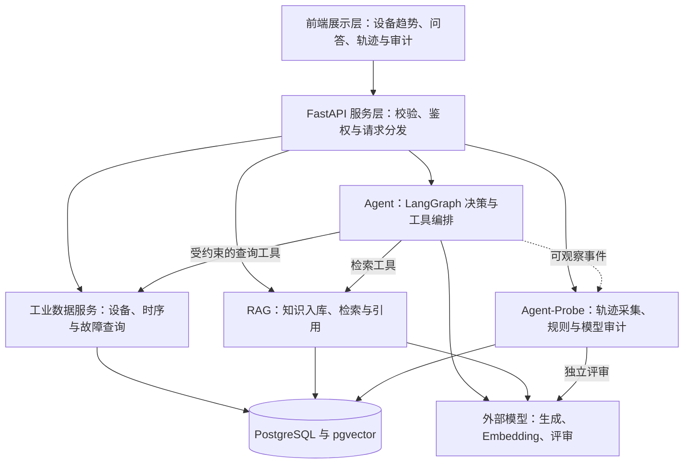
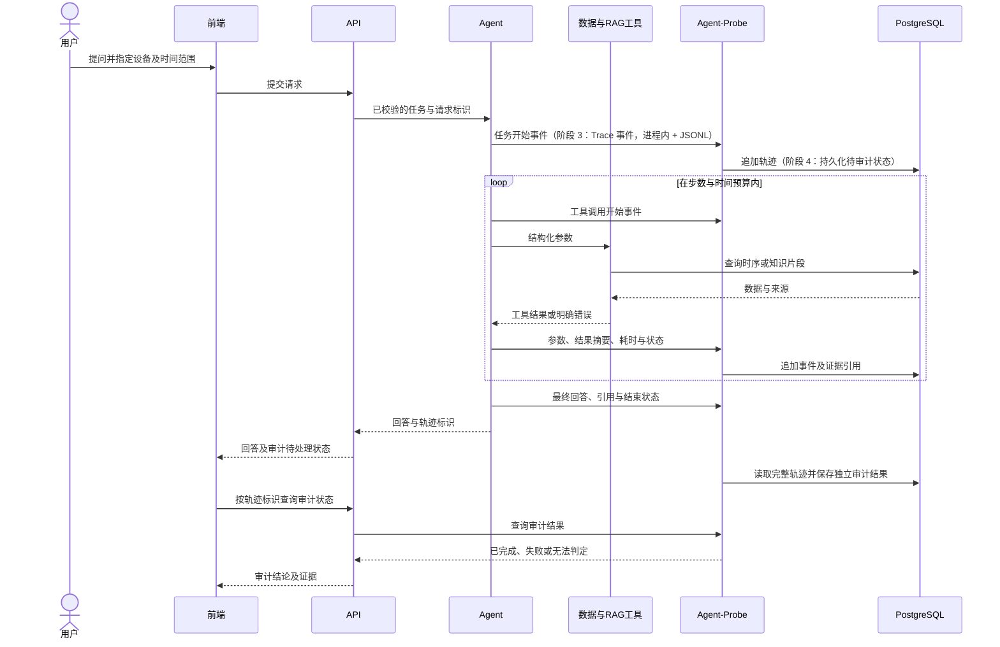

# 系统架构设计

## 范围与边界

本文件描述目标架构。截至阶段 3，**存储层、数据服务、只读查询 API、知识库与 RAG 检索问答、
LangGraph 单 Agent 与只读工具、最小执行 Trace 已实现**：
`backend/app/models/` 的 ORM 模型、`backend/alembic/` 的迁移、`backend/app/services/` 的
导入/查询/知识服务、`backend/app/rag/` 的解析/切分/Embedding/混合检索/问答、
`backend/app/api/` 的 FastAPI 接口、以及 PostgreSQL + pgvector 的 Compose 部署；
Agent-Probe（阶段 4）与前端（阶段 5）仍未实现。初期采用模块化单体：一个 FastAPI 后端、
一套 React 前端和 PostgreSQL 数据库。Agent-Probe 是本项目的行为追踪与审计模块名称，
尚未选定或接入同名外部产品。

已实现的调用边界（阶段 1B/1C/2）：

| 已实现 | 位置 | 说明 |
| --- | --- | --- |
| 数据导入 | `backend/app/services/metropt_import.py`、`scripts/import_metropt.py` | 分块读取、COPY 批量写、数据库层幂等、质量标记 |
| 只读查询（Repository） | `backend/app/services/queries.py` | 设备、时间窗、统计、故障区间、冻结候选、覆盖度 |
| 查询服务（Service） | `backend/app/services/{equipment_info,sensor_history,sensor_statistics,fault_events,data_quality}.py` | 不依赖 FastAPI 的业务函数，未来可直接包装成 Agent Tool |
| HTTP 接口（Router） | `backend/app/api/`、`backend/app/schemas/` | 参数校验、响应装配、统一异常、OpenAPI 文档 |
| 存储结构 | `backend/alembic/versions/` | 表结构唯一来源，应用启动不建表 |
| 知识入库 | `backend/app/rag/{parsing,chunking,embedding,ingest}.py`、`scripts/ingest_knowledge.py` | PDF 解析、两套切分、真实向量化、幂等写入与版本管理 |
| 知识检索 | `backend/app/rag/retrieval/` | 向量、关键词与 RRF 混合检索，来源/页码/适用范围过滤 |
| RAG 问答 | `backend/app/rag/answer.py` | 证据选择、Prompt、引用逐字校验、越界与注入防护 |
| 知识接口 | `backend/app/api/routes/knowledge.py`、`app/services/knowledge.py` | 检索/问答/文档/健康检查，只读 |
| Agent 工作流 | `backend/app/agent/{graph,nodes,state,intent,planner_llm}.py` | LangGraph 单 Agent：意图 → 规划 → 执行 → 检查 → 证据整合 → 结束，带预算与超时 |
| Agent 工具 | `backend/app/agent/tools/` | 6 个只读工具（5 数据 + 1 知识检索），Pydantic 校验、超时、有限重试 |
| Agent 证据与回答 | `backend/app/agent/{evidence,answer}.py` | 事实清单（D 标签）、知识片段（K 标签）、数值接地、引用逐字校验 |
| Agent Trace | `backend/app/agent/trace.py` | 结构化事件（最小契约，供阶段 4 消费），不含敏感信息 |
| Agent 接口与配置 | `backend/app/api/routes/agent.py`、`app/schemas/agent.py`、`app/agent/{service,config,context}.py` | `POST /api/v1/agent/chat`、`GET /api/v1/agent/traces/{id}`；预算配置与只读会话 |

Agent 负责完成业务问题；Agent-Probe 负责观察执行过程并评估合规性与证据质量。审计通过不代表设备安全认证，也不等同于答案必然正确。

## 系统架构图



## 模块职责、输入输出及依赖

| 模块 | 输入 | 输出 | 职责与依赖 |
| --- | --- | --- | --- |
| 前端 | 用户问题、设备选择、时间范围 | 查询请求、趋势与审计视图 | 仅调用 API，不直连数据库或持有模型密钥 |
| API | HTTP 请求与身份上下文 | 结构化响应、请求标识或错误 | 参数校验、授权、分发；不承载检索与审计算法 |
| 工业数据服务 | 设备标识、时间窗口、指标与聚合要求 | 带单位、来源、时间边界的数据 | 通过 ORM 与数据库会话查询；限制范围和返回量 |
| RAG（已实现） | 查询文本、适用设备范围；入库时为知识文档 | 文档片段、相关性分值、引用与适用性 | 负责解析、切分、向量化与检索，依赖 Embedding 和 pgvector；不执行文档中的指令 |
| Agent（已实现） | 问题、上下文、工具契约 | 回答、引用、执行状态与轨迹标识 | LangGraph 编排；调用数据/RAG 工具，不实现底层查询；数值与引用受接地校验约束 |
| Agent-Probe | 结构化事件、证据快照与策略版本 | 规则命中、模型评审、证据定位与评审状态 | 独立读取轨迹与证据，不替 Agent 决策或修补回答 |
| 存储层 | 受约束的读写请求 | 实体、时序、片段向量与审计记录 | PostgreSQL 管理一致性，pgvector 管理向量检索 |

基础目录约定：`models` 定义存储实体，`schemas` 定义跨模块契约，`db` 管理连接与事务，`core` 管理通用配置及日志。`services` 仅处理工业数据领域，不重复实现 RAG、Agent 或 Audit。

## 查询服务分层与契约（阶段 1C 已实现）

调用方向固定为 **Router → Service → Repository → PostgreSQL**，禁止跨层调用：

| 层 | 位置 | 职责 | 明确禁止 |
| --- | --- | --- | --- |
| Router | `backend/app/api/routes/` | HTTP 方法/路径、查询参数声明、状态码与响应装配 | 写 SQL、做统计计算 |
| Schema | `backend/app/schemas/` | 请求/响应类型、单位与语义文档、OpenAPI 示例 | 承载业务逻辑 |
| Service | `backend/app/services/*.py`（5 个模块） | 时间窗与传感器校验、统计语义整理、质量语义与提示、故障重叠判定 | 依赖 `Request`/`Response` |
| Repository | `backend/app/services/queries.py` | SQLAlchemy 查询与聚合，返回 dataclass | 依赖 HTTP 或 Pydantic |
| 存储 | PostgreSQL 17 | 一致性、索引、聚合、窗口函数 | — |

**时间契约**：`observed_at` 为 `timestamp without time zone`（源数据无时区）。

- API 只接受无时区 ISO 8601；带 `Z` / `+08:00` 的输入返回 **422 `timezone_not_supported`**，不做任何隐式换算。
- 所有区间左闭右开 `[start, end)`。实现上复用阶段 1B 的闭区间查询：`[start, end)` 等价于
  `[start, end − 1µs]`，依据是数据库 CHECK 约束 `observed_at = (source_timestamp_raw)::timestamp`
  保证时间戳精确到秒、不含微秒（见 `queries.half_open_upper_bound()`）。

**Agent-ready 业务函数**（均以 `Session` 为第一参数，返回 dataclass，不依赖 FastAPI）：

| 函数 | 位置 | 未来 LangGraph Tool |
| --- | --- | --- |
| `get_equipment_info` / `list_equipment_infos` | `services/equipment_info.py` | `get_equipment_info` |
| `get_sensor_history` | `services/sensor_history.py` | `get_sensor_history` |
| `get_sensor_statistics` | `services/sensor_statistics.py` | `get_sensor_statistics` |
| `get_fault_events` | `services/fault_events.py` | `get_fault_events` |
| `get_data_quality` | `services/data_quality.py` | `get_data_quality` |

**边界与安全**：服务只读（会话结束统一 `rollback` + `close`）；列表查询有硬上限；
传感器名只能命中白名单；错误响应不包含 SQL、连接串或堆栈；`fault_events` 只表达区间级事实，
不在 `sensor_readings` 上生成逐行故障标签。

## RAG 实现（阶段 2）

```
PDF（sources.json 登记 URL/SHA-256/许可/适用范围）
  → PyMuPDF 按页解析（页码、标题、段落、页眉页脚清理）
  → 切分（fixed-v1 / structural-v1 并存，带 chunking_version）
  → Ollama bge-m3（1024 维，L2 归一化，失败重试，禁止假向量）
  → documents / document_chunks / knowledge_ingest_runs
  → 向量（HNSW）+ 关键词（ASCII 标识符 + 中文 bigram + tsvector）
  → RRF 融合（k=60）
  → 证据选择 → Prompt → qwen2.5 → support_quotes 逐字校验 → 引用
```

关键边界：

- 知识库使用独立连接串 `RAG_DATABASE_URL`（未设置时回退 `DATABASE_URL`）；
  测试强制指向 `*_test` 库，入库 CLI 拒绝写入非 `*_dev` / `*_test` 库；
- 文档适用性是一等字段：`metropt3_direct` 与 `generic_compressor` 在检索与回答中都必须区分；
- 同一索引只允许一种 Embedding 模型/版本；不匹配时抛错而不是返回空结果；
- 文档内容是不可信数据，模型输出中的代码/SQL 会被拒绝返回；
- 引用必须能定位到文档、页码与 Chunk ID，并尽量提供逐字引文。

细节与实测指标见 [RAG 设计](rag_design.md) 与 [RAG 评估](rag_evaluation.md)。

## Agent 实现（阶段 3）

```
问题 → analyze（意图 + 槽位）→ plan（工具计划 + 预算裁剪）
     → execute（一个工具：校验 → 超时 → 有限重试 → 结构化结果）
     → check（异常判断补对照窗口 / 空结果补质量查询 / 检索为空换关键词；预算与轮次检查）
     → compose（事实清单 D#/K# → LLM 叙述或确定性渲染 → 数值接地 + 引用逐字校验）
     → finalize（终态 + Trace 摘要）
```

关键边界：

- **单 Agent + 多工具**：不做多 Agent 协作；复杂问题用“计划 + 补充查询”解决。
- **工具只读**：数据工具复用阶段 1C Service，知识工具复用阶段 2 混合检索（不调用 RAG 生成）；
  Agent 代码中没有 SQL；会话连接参数 `default_transaction_read_only=on`。
- **数值与引用接地**：数据小节由事实清单确定性渲染；模型只能写结论句/知识要点/推断；
  回答中的数字必须命中事实清单（含知识原文与用户问题中的数字），
  知识结论必须带逐字摘录，否则丢弃并记录原因。
- **预算显式**：工具调用 ≤ 8、决策轮次 ≤ 5、节点步数 ≤ 24、整轮 ≤ 180 s，每个工具独立超时；
  错误按类别决定是否重试、是否阻断依赖工具。
- **位置独立的数据源**：工业数据用 `DATABASE_URL`、知识用 `RAG_DATABASE_URL`，
  不假设同库（当前主库 `0004`、知识库 `0007`）。
- **Trace 与审计分离**：本阶段只产出结构化事件（阶段 4 消费），不做风险评分或 LLM 审计。

细节见 [Agent 设计](agent_design.md)、[工具契约](agent_tools.md)、[Agent 评估](agent_evaluation.md)。

## 主要业务数据流



知识入库（阶段 2 已实现）属于独立离线流程：来源登记 → 文档解析 → 切分 → Embedding → 文档和片段保存。工业数据入库流程为来源登记 → 数据校验 → 标准化 → 幂等写入。两者不混用：传感器值通过数据工具查询，知识文档提供解释与规程。

## 业务执行与审计隔离

- Agent 工具限定为只读查询和检索；结构化参数由工具层再次校验，不执行模型输出的任意 SQL。写操作及真实设备控制不属于初期范围。
- 工具调用前的授权、参数检查、预算和超时属于执行控制，事后审计不能替代这些控制。
- 采集可观察输入输出、工具名、事件序号、父事件、时间、耗时、状态、错误及模型/提示词版本；不要求记录模型隐藏推理。
- 用 `trace_id` 关联任务，`event_id` 与序号定位事件；按白名单脱敏，限制正文体积，保留来源及必要证据快照以便回放。
- 规则审计检查越权尝试、参数范围、调用失败后的处理及引用完整性；LLM 评审检查证据支持度和建议一致性，其输出只作为评审意见。
- 检索文档与工具返回值均视为不可信内容；提示注入防护和工具权限属于执行边界，审计记录异常尝试。
- 初期采用进程内采集加持久化待审计状态，避免引入消息队列。任务结束后触发评审，进程重启后按状态恢复；恢复机制在阶段 4 实现。
- 轨迹写入失败必须暴露“轨迹不完整”状态；评审失败、未运行和无法判定不得显示为通过。审计错误不修改原始回答。

## 可测试性与独立开发

先约定查询、检索、工具结果、轨迹事件、审计输出的结构，再分模块实现。通过模型替身验证业务与审计逻辑，通过 PostgreSQL/pgvector 集成测试验证存储语义。RAG 用带相关片段标注的问题集，审计用人工标注轨迹；与开发调试样本隔离。前端可基于明确标为模拟的契约样例开发。

模型超时、无检索结果、设备不匹配、空数据窗口、轨迹缺失和评审失败均作为独立测试场景。保留期限、访问权限细则、调用预算和性能目标待验证后确定。
